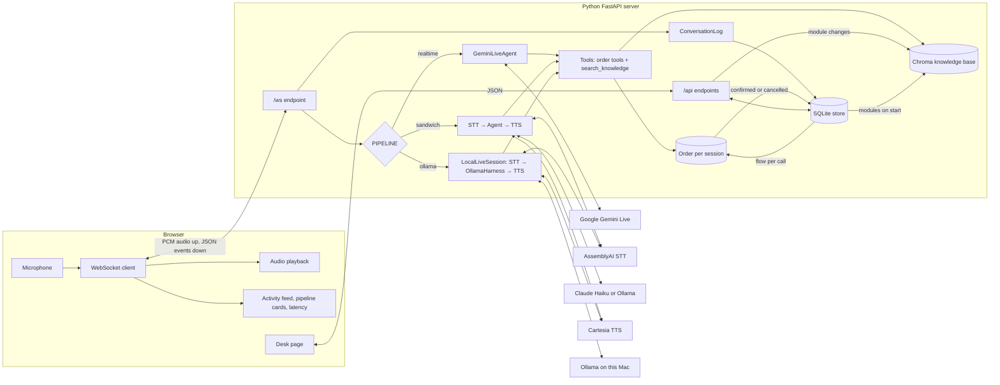

# Architecture

This document describes the parts of the Ustad Hotel voice ordering agent and how they connect. For code-level detail, see [technical-doc.md](technical-doc.md). For the RAG design, see [rag_doc.md](rag_doc.md).

## System context

The system has three parts:

1. **Web client** (`components/web`): a Svelte app in the browser with two pages.
   - The order page (`/`) records the microphone, plays agent audio and shows the conversation.
   - The desk (`/desk/`) is for shop staff. It shows call transcripts and customers, holds the knowledge modules and the ordering flow, and sets the voice model.
2. **Backend** (`components/python` or `components/typescript`): a server that runs the voice pipeline. It also serves the built web client.
3. **External services**: speech, language and voice models in the cloud (or Ollama on the local machine).

The order page and the backend talk over one WebSocket at `/ws`. The browser sends raw audio. The backend sends JSON events. The desk uses the JSON API under `/api`.



## Backends

There are two backends with the same WebSocket contract:

| Backend | Pipelines | Tools | RAG |
|---------|-----------|-------|-----|
| Python (`components/python`) | `realtime` (default), `sandwich` and `ollama` | Full order flow and `search_knowledge` | Yes |
| TypeScript (`components/typescript`) | `sandwich` only | `add_to_order`, `confirm_order` | No |

The rest of this document describes the Python backend.

## Pipelines

The `PIPELINE` environment variable selects one pipeline when the server starts.

### Realtime pipeline (default)

One stage does all the work. `GeminiLiveAgent` (`src/gemini_live.py`) opens one Gemini Live session for each WebSocket connection.

- The browser audio (16 kHz PCM) goes directly to Gemini.
- Gemini hears the audio, decides on tool calls, and speaks the reply (24 kHz PCM).
- The agent translates Gemini messages into the same events that the sandwich pipeline emits. Thus the web client works with both pipelines.
- Gemini keeps the conversation history inside the session.

This pipeline has the lowest latency and supports barge-in. When the user speaks over the agent, the backend sends an `interrupted` event and the client stops playback.

### Sandwich pipeline

Three stages run as a chain of async generators (LangChain `RunnableGenerator`):

```
Audio → [STT: AssemblyAI] → [Agent: LangChain create_agent] → [TTS: Cartesia] → Events
```

1. **STT** streams audio to AssemblyAI and emits `stt_chunk` and `stt_output`.
2. **Agent** runs the LangChain agent on each `stt_output`. It emits `agent_chunk`, `tool_call`, `tool_result` and `agent_end`. The LLM is Claude Haiku 4.5 or a local Ollama model (`LLM_PROVIDER`).
3. **TTS** collects the agent text and sends it to Cartesia on `agent_end`. It emits `tts_chunk`.

Each stage passes all upstream events through, so the client sees every event. `InMemorySaver` keeps the conversation history for each connection.

The TTS stage sends text to Cartesia one sentence (or long clause) at a time, so speech starts before the reply is complete. All parts of one reply share one Cartesia context, and one Cartesia connection serves the whole session.

### Ollama pipeline

This pipeline works as voice to voice, like the realtime pipeline. The agent is `OllamaHarness` (`src/ollama_harness.py`), which runs a small model on the local Ollama server (default `qwen3.5:4b`). The model cannot hear or speak, so `LocalLiveSession` (`src/local_live.py`) puts speech to text before it and text to speech after it:

- **Ears:** `LocalSTT` (`src/local_stt.py`) with Parakeet in the local voice service. If the service has no STT ready, AssemblyAI.
- **Voice:** the desk voice through the voice service, else Cartesia.
- **Barge-in:** when the customer speaks while the agent thinks or talks, the agent stops and the backend sends `interrupted`. The harness stops the turn at a safe point, so tools that started still finish.
- After a silence, the agent checks in.

With the voice service running and a desk voice in use, the whole call runs on this Mac. See [voice-doc.md](voice-doc.md).

A small model needs more help than Claude or Gemini, so the harness does work that the prompt does in the other pipelines:

- **Stage in code.** `order_stage()` (`src/orders.py`) gets the current step from the order and the flow set on the desk. Each turn, the harness adds a short note with the step instruction and the known order facts.
- **Stage tool filter.** The model sees all tools, but the harness runs only the tools of the current step and the steps before it.
- **One tool round per turn.** The model may call tools once, then it must speak. This stops chains of invented calls.
- **Checks on tool calls.** Arguments must fit the function signature. The phone and OTP tools run only if the user said numbers. The harness sends the OTP itself when the flow reaches the OTP step. Known argument mistakes are repaired from the user's words.
- **Retrieval before the call.** For questions, the harness searches the knowledge base first and puts the chunks in the note. This saves one model round trip.
- **Prompt cache.** Each request extends the previous one exactly, so Ollama reuses most of its cached prompt.

The pipeline is built from plain async tasks, not a `RunnableGenerator` chain, so the agent can greet the customer before the customer speaks and can be cut off.

## Tools

Both pipelines use one shared list of plain Python functions:

- **Order tools** (`src/orders.py`): `save_customer_name`, `save_delivery_address`, `add_to_order`, `set_payment_method`, `save_order_detail`, `save_phone_number`, `send_otp`, `verify_otp`, `cancel_order`.
- **Knowledge tool** (`src/main.py`): `search_knowledge`.

Gemini gets the tools as function declarations. LangChain gets them as tools. The model calls a tool, and the result goes back to the model as text.

## State

| State | Scope | Where |
|-------|-------|-------|
| Order (name, address, items, payment, phone, OTP) | One WebSocket connection | `ContextVar` in `src/orders.py`, in memory |
| Conversation history | One WebSocket connection | Gemini session, LangGraph `InMemorySaver` or `OllamaHarness.history` |
| Knowledge base | All connections | Chroma on disk at `components/python/.chroma/`, built from the modules in SQLite |
| Desk voices | All connections | `voices` table in SQLite and WAV samples in `components/python/data/voices/` |
| Mode, customers, finished orders, transcripts, knowledge modules, flow | All connections | SQLite at `components/python/data/shop.db` (`src/store.py`) |

A restart loses orders in progress and the model's conversation history. The SQLite file keeps the mode chosen on the desk, the customers, their confirmed or cancelled orders, the transcript of every call, the knowledge modules and the flow. The Chroma index is rebuilt from the modules on start.

## Flow and knowledge from the desk

Staff set what the agent knows and what it asks on the desk. Both are read by every voice mode:

- **Knowledge modules** (Training section) are the source of the Chroma index. A change re-indexes one module. The dish names of Menu modules also go into the prompt.
- **The flow** (Flow section) sets the order of the steps and adds custom steps. `start_order` reads it once per call. Gemini and Claude get it as numbered steps in the system prompt. The Local harness gets one step per turn from `order_stage`. The order tools enforce it.

The agents are cached by prompt, so a change applies to the next call with no restart. See [training-doc.md](training-doc.md).

## Event contract

The backend sends these JSON events on the WebSocket. Types are in `src/events.py` and `components/web/src/lib/types.ts`.

| Event | Meaning |
|-------|---------|
| `stt_chunk` | Partial user transcript |
| `stt_output` | Final user transcript for one turn |
| `agent_chunk` | Part of the agent reply text |
| `tool_call` | The agent called a tool (name and arguments) |
| `tool_result` | The tool result |
| `tts_chunk` | Base64 agent audio |
| `agent_end` | The agent turn is done |
| `interrupted` | The user spoke over the agent (realtime and ollama) |

## Deployment view

- One process: `uv run src/main.py` starts uvicorn on port 8000.
- The server serves the web build from `components/web/dist` at `/`.
- `make dev-py` runs the web build in watch mode and the server with reload.
- API keys come from `.env` (see `.env.example`).
- Optional second process: the local voice service on port 8001 (`components/voice/server.py`, its own environment). `make dev-py` starts it when it is installed. `make dev-voice` starts it alone. The sandwich and ollama pipelines speak through it when a desk voice is in use. See [voice-doc.md](voice-doc.md).
