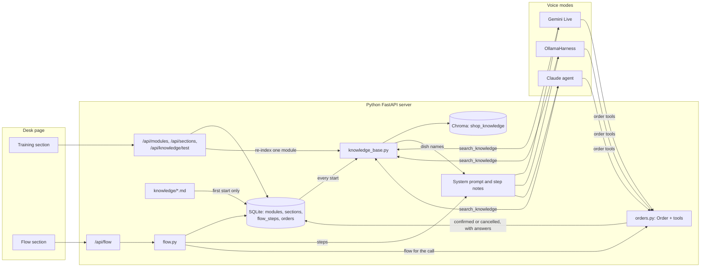
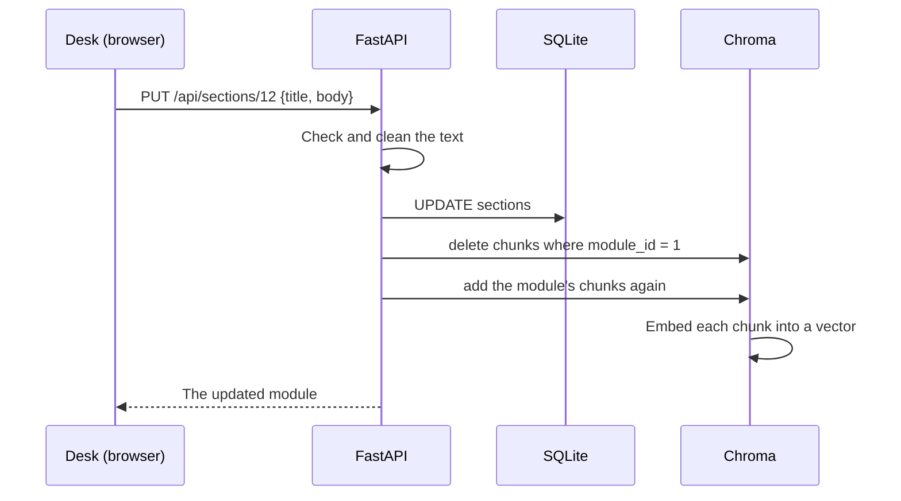
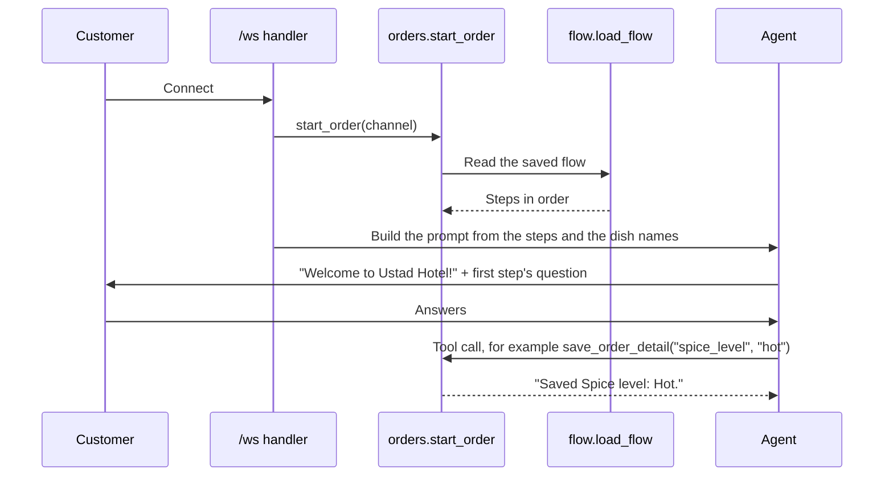

# Training and Flow on the desk

This document describes two desk sections:

- **Training** holds everything the agent knows about the shop: the menu, the FAQ, the allergens and any module that staff add.
- **Flow** sets the steps the agent asks for and their order. Staff can add their own steps.

It has four parts:

1. [Summary](#summary)
2. [In simple words](#in-simple-words)
3. [Architecture](#architecture)
4. [Technical details](#technical-details)

For the rest of the system, see [architecture.md](architecture.md), [technical-doc.md](technical-doc.md), [functional-doc.md](functional-doc.md) and [rag_doc.md](rag_doc.md).

## Summary

- **Training** (`/desk/#training`) lists the knowledge **modules**. The first start creates Menu, FAQ and Allergens from the files in `components/python/knowledge/`. After that, staff edit them on the desk.
- A module has a name, a type (Menu, Notes or Q&A), an optional intro, and **sections** in order. Staff can add, edit, delete and reorder modules and sections.
- Every change is saved in SQLite and indexed in Chroma at once. All three voice modes (Gemini, Local and Claude) use it from the next question. No restart is needed.
- The dish names in Menu modules also go into the agent's prompt. A new dish is offered in the next call.
- **Test a Question** runs the same search the agent runs and shows the results.
- **Flow** (`/desk/#flow`) lists the steps of an order. The built-in steps are Name, Delivery address, Order items, Payment method and Phone number, and they can be put in any order. OTP is always last.
- Staff can add **custom steps**, for example "Spice level" with the choices Mild, Medium and Hot. A custom step can be required or optional. The answer is saved with the order and shows on the Customers page.
- The order tools check the flow. For example, `add_to_order` refuses items until the required steps before Order items are done.
- Every new call reads the saved flow. A call in progress keeps the flow it started with.
- This is not model training. The model weights do not change. The agent looks up the answer while it talks (retrieval-augmented generation, RAG) and follows steps that are written into its instructions.

## In simple words

### Training: the agent's notebook

Think of the agent as a new waiter with a notebook. Before the waiter answers a question about the shop, the waiter looks in the notebook.

The Training section is that notebook. It has chapters, called **modules**:

- **Menu**: the dishes and prices, one category per section.
- **FAQ**: hours, delivery, payment and refunds.
- **Allergens**: what each dish contains.
- Any chapter you add, for example **Offers** or **Catering**.

Each module has pages, called **sections**. A section has a title and some text.

When a customer asks "Is Chicken 65 gluten free?", the agent searches the notebook, finds the Gluten section of Allergens, and answers from it. The customer does not have to use the same words as the notebook, because the search matches meaning.

A module has one of three types. The type changes the labels on the form and how the agent uses it:

| Type | A section is | Example |
|------|--------------|---------|
| Menu | A category and its dishes, one per line as `Name: description, price` | Starters → `Chicken 65: spicy fried chicken bites, ₹210.` |
| Notes | A topic and the facts about it | Delivery → `We deliver anywhere in Bangalore.` |
| Q&A | A question a customer asks and the answer to give | `Do you deliver to Whitefield?` → `Yes, in about 45 minutes.` |

The agent also reads the dish names from Menu modules before the call starts. So it can name the starters without searching first.

### Flow: the agent's checklist

The flow is the checklist the waiter follows for every order. The default checklist is:

1. Name
2. Delivery address
3. Order items
4. Payment method
5. Phone number
6. OTP

You can change the order. For example, move Order items to the top, so the agent asks "What would you like to order?" first. The agent's greeting always asks the question of the first step.

You can add your own question, for example "How spicy would you like your food?". If you give choices, the agent accepts only those. If you mark the step optional, the customer can say "no thanks".

OTP stays last, because it confirms the order. Phone number can move, for example to the top, so the agent can ask for it first. The built-in steps cannot be removed, because the shop needs them to deliver the order.

### How to use Training

1. Open the desk and choose **Training**.
2. Choose a module, for example **Menu**.
3. To change a section, choose **Edit** under it, change the text and choose **Save Changes**.
4. To add a section, fill in **Add Section** at the bottom and choose **Add Section**.
5. Use the arrow buttons to change the order of sections.
6. To add a module, choose **+ New Module**, enter a name, choose a type and choose **Create Module**.
7. In **Test a Question**, type a question the way a customer would say it and choose **Test**.
8. Make sure the first result comes from the module you expect.

### How to use Flow

1. Open the desk and choose **Flow**.
2. Use the arrow buttons to move a step up or down.
3. To change what the agent says in a step, choose **Edit** and change **The agent asks** or **Extra instructions**.
4. To add a step, fill in **Add Step** and choose **Add Step**. The step goes just before OTP. Move it where you want it.
5. Choose **Save Flow**. Until you save, nothing changes for customers.
6. Read **What the Agent Follows** to see the instructions the agent gets.
7. To go back to the original steps, choose **Reset to Default**.

### Why not real training

Real training (fine-tuning) changes the model itself. It needs hundreds of examples, a strong GPU and hours of work. It is not possible for Gemini, because Google runs that model. And a fact learned that way is hard to change later.

The notebook and checklist approach has none of these problems:

- A change applies from the next question or the next call.
- It works the same for the cloud models and the model on this Mac.
- You can see, edit and delete everything the agent uses.

## Architecture

### Where the parts fit



### Two stores for knowledge

| Store | Role | Survives a restart |
|-------|------|-------------------|
| SQLite `modules` and `sections` | The source of truth. The desk reads and writes it. | Yes |
| Chroma `shop_knowledge` collection | The search index. The agent reads from it. | Rebuilt from SQLite on every start |
| `knowledge/*.md` files | Seed data for the first start | Not read again after the first start |

SQLite holds the text because it holds the rest of the desk data and it is easy to back up. Chroma holds a copy as vectors, because only a vector search can match questions by meaning.

### Edit a section: what happens



### A call starts: what happens



### How each voice mode follows the flow

| Mode | How it gets the flow |
|------|---------------------|
| Gemini | The system prompt has the numbered steps (`flow.steps_prompt`). The greeting asks the first step's question. |
| Claude | The same system prompt, through the LangChain agent. |
| Local | The harness asks `orders.order_stage` for the current step on each turn. It sends only that step's instruction and allows only the tools of that step and the steps before it. |

The agents are cached by prompt. When staff change the flow or a menu module, the next call builds a new agent with the new prompt.

## Technical details

### Files changed

| File | Change |
|------|--------|
| `components/python/src/flow.py` | New. The `Step` type, the default flow, `validate`, `load_flow`, `save_flow`, `reset_flow`, `greeting`, `step_instruction` and `steps_prompt`. |
| `components/python/src/store.py` | New tables `modules`, `sections` and `flow_steps`, and the column `orders.details`. Functions for modules, sections and the flow. The old `training` table is moved into a module and dropped. |
| `components/python/src/knowledge_base.py` | Indexes modules from the store. New `seed_modules`, `parse_markdown`, `reindex_module`, `remove_module`, `search_results` and `menu_overview`. |
| `components/python/src/orders.py` | `Order` keeps the call's flow and the custom answers (`details`). `order_stage` walks the flow. New tools `save_order_detail` and `save_phone_number`. `send_otp` takes no arguments and uses the saved phone. `add_to_order` and `send_otp` check the flow. `cancel_order` keeps the phone. |
| `components/python/src/ollama_harness.py` | Step notes and allowed tools come from the flow. The menu in the persona comes from `menu_overview`. `_send_otp_when_due` sends the OTP when the flow reaches the OTP step. |
| `components/python/src/gemini_live.py` | `GeminiLiveAgent` takes the greeting as an argument. |
| `components/python/src/main.py` | `build_shop_prompt(steps)` replaces the fixed prompt. Agents are cached by prompt. New routes for modules, sections, the knowledge test and the flow. |
| `components/web/src/lib/api.ts` | Types and request functions for modules, sections and the flow. `OrderRecord.details`. |
| `components/web/src/lib/desk/TrainingSection.svelte` | Test box, module list and editor pane. |
| `components/web/src/lib/desk/ModuleEditor.svelte` | New. Module details form, section list and section form. |
| `components/web/src/lib/desk/FlowSection.svelte` | New. Step list, step editor, add step form and the prompt preview. |
| `components/web/src/lib/desk/Desk.svelte` | Adds **Flow**. The phone tab bar has 5 tabs. Route `#training/<id>` opens a module. |
| `CustomersSection.svelte`, `ConversationsSection.svelte` | Show custom answers on orders, and label `save_order_detail` in transcripts. |

### Data model

```sql
CREATE TABLE modules (
    id INTEGER PRIMARY KEY AUTOINCREMENT,
    name TEXT NOT NULL,
    kind TEXT NOT NULL DEFAULT 'notes',   -- 'menu', 'notes' or 'qa'
    intro TEXT NOT NULL DEFAULT '',
    position INTEGER NOT NULL,
    created_at REAL NOT NULL,
    updated_at REAL NOT NULL
);
CREATE TABLE sections (
    id INTEGER PRIMARY KEY AUTOINCREMENT,
    module_id INTEGER NOT NULL REFERENCES modules(id),
    title TEXT NOT NULL,
    body TEXT NOT NULL,
    position INTEGER NOT NULL,
    created_at REAL NOT NULL,
    updated_at REAL NOT NULL
);
CREATE TABLE flow_steps (
    key TEXT PRIMARY KEY,          -- 'name', 'address', 'items', 'payment', 'phone', 'otp' or a slug such as 'spice_level'
    kind TEXT NOT NULL,            -- 'builtin' or 'custom'
    label TEXT NOT NULL,
    ask TEXT NOT NULL,             -- the question the agent asks
    notes TEXT NOT NULL DEFAULT '',
    required INTEGER NOT NULL DEFAULT 1,
    choices TEXT NOT NULL DEFAULT '[]',  -- JSON list
    position INTEGER NOT NULL
);
-- orders gets: details TEXT NOT NULL DEFAULT '{}'  (JSON: step key → answer)
```

An empty `flow_steps` table means the default flow in `flow.py`. **Reset to Default** empties the table.

`store._migrate` runs once per process. It adds `orders.details` to a database from an older version. `pop_legacy_training` moves rows from the `training` table of the first Training version into a Q&A module called "Questions & Answers", then drops the table.

### Seeding

`seed_modules()` runs at start, before `ingest()`:

1. If the setting `knowledge_seeded` is not `1` and there are no modules, it reads each `knowledge/*.md` file in the order `menu.md`, `faq.md`, `allergens.md`, then any other file by name.
2. `parse_markdown` splits a file into the `# ` title (the module name), the text before the first `## ` (the intro), and one section per `## ` heading.
3. `menu.md` gets the type `menu`. The other files get `notes`.
4. It sets `knowledge_seeded` to `1`. If staff later delete every module, the files are not loaded again.

To load the files again, delete `components/python/data/shop.db`, or delete the modules table rows and the `knowledge_seeded` setting.

### Chunks

| Chunk | ID | Text |
|-------|----|------|
| Module intro | `module-<id>` | Module name, a blank line, the intro |
| Section of a Menu or Notes module | `section-<id>` | `<module name>: <title>`, a blank line, the body |
| Section of a Q&A module | `section-<id>` | The question, a blank line, the answer |

Every chunk has the metadata `{"source": <module name>, "module_id": <id>}`.

A Q&A chunk leaves out the module name. The customer's words are closest to the question alone, so a Q&A entry ranks first for the question it answers.

### Indexing

Chroma embeds each chunk with its default model, `all-MiniLM-L6-v2` (384 dimensions), on the CPU. It needs no API key.

- **On start**, `ingest()` deletes the collection, creates it again and adds the chunks of every module.
- **On a change**, the route calls `reindex_module(module_id)`. It deletes the chunks with that `module_id` and adds the module's chunks again. A module has about 10 chunks, so this takes milliseconds. Renaming a module changes the text of every chunk, which is why the whole module is re-indexed.
- **On a module delete**, the route calls `remove_module(module_id)`.

SQLite is written first. If the Chroma step fails, the change is still saved and comes back into the index on the next start.

`_get_collection()` reopens the collection if another process rebuilt it, for example a `uvicorn --reload` worker.

### Search

`search_results(query, k=3)` returns a list of matches:

```json
[
  {"id": "section-17", "source": "Questions & Answers", "module_id": 4, "text": "Do you deliver to Whitefield?\n\nYes...", "distance": 0.408},
  {"id": "section-10", "source": "FAQ", "module_id": 2, "text": "FAQ: Delivery\n\n...", "distance": 1.2}
]
```

`distance` is the squared L2 distance between the vectors. Lower means closer. In testing, a paraphrase of a Q&A question scored 0.33 to 0.41. Unrelated text scored above 1.7.

`search(query, k=3)` is the function behind `search_knowledge`. It joins the `text` fields with `\n\n---\n\n`. The Local mode calls `search(query, 2)` itself before the model runs, when the customer's words look like a question.

### Menu overview

`menu_overview()` builds one line from every Menu module. For each section, it takes the text before the colon on each line of the body as a dish name:

```
Biriyani: Chicken Biriyani, Mutton Biriyani. Mandi: Chicken Mandi, Mutton Mandi. Starters: ...
```

A line with no colon, or with more than 40 characters before the colon, is skipped. A section with no dishes shows only its title, for example `Cheeses`. The line goes into the Gemini and Claude prompt and into the Local persona as `Menu: ...`.

### Flow rules

`flow.validate` checks a flow from the desk and raises `ValueError` with a message for staff:

- At most 12 steps. At most 10 choices per custom step.
- Every step has a name and a question.
- All six built-in steps are present, each once.
- `otp` is the last step.

A flow saved before phone and OTP were split has one built-in step `confirm`. `load_flow` replaces it with the default `phone` and `otp` steps.
- A custom step's key is a slug of its name, for example `Spice level` → `spice_level`. It cannot be a built-in key or repeat another step.

Built-in steps keep `required = true` and no choices. Their tools are fixed:

| Step | Tools |
|------|-------|
| `name` | `save_customer_name` |
| `address` | `save_delivery_address` |
| `items` | `add_to_order` |
| `payment` | `set_payment_method` |
| `phone` | `save_phone_number` |
| `otp` | `send_otp`, `verify_otp` |
| Any custom step | `save_order_detail(step, value)` |

### Order stage

`orders.order_stage(order)` returns the key of the first step that is not done, or `confirmed`:

- A built-in step is done when the order has its data: a name, a verified address, at least one item, a payment method, a phone number, or a confirmed OTP.
- A custom step is done when `order.details` has its key.
- **Order items** stays the current step while the customer adds items. It ends when the customer answers any later step. This lets the customer order several dishes.

The tools enforce two rules with `_missing_before`:

- `add_to_order` needs every required step before `items`. For example, with the default flow it asks for the address first.
- `send_otp` needs every required step before `otp`, including the phone number.

The OTP step tells Gemini and Claude to call `send_otp` first and then ask for the code. The Local model has one tool round per turn, so it cannot do both in one turn. Instead, the harness calls `send_otp` itself after the tool round in which the flow reaches the OTP step. It records the call in history as part of that round. Then the step note only asks for the code, so the model does not send a second one.

### save_order_detail

```python
def save_order_detail(step: str, value: str) -> str
```

1. It finds the custom step with this key in the call's flow. An unknown key returns the list of custom keys.
2. On an optional step, an empty answer or a short "no", "no thanks", "skip" or "none" saves `none`. An answer that names a choice wins: "no, make it mild" saves `Mild`.
3. With choices, the answer must contain one of them, case-insensitive. Otherwise the tool tells the agent to ask again with the choices.
4. It saves the answer in `order.details`. `verify_otp` and `cancel_order` save the details with the order.

### Prompts

`main.build_shop_prompt(steps)` fills `SHOP_PROMPT` with three parts:

1. `flow.greeting(steps)`: "Welcome to Ustad Hotel!" and the first step's question.
2. `flow.steps_prompt(steps)`: one numbered line per step, from `step_instruction`. The line has the question, the extra instructions, the choices, an optional note, and the tool to call.
3. `knowledge_base.menu_overview()`.

`sandwich_agent(prompt)` and `realtime_agent(prompt, greeting)` use `functools.lru_cache(maxsize=4)`. The same prompt reuses the agent. A new prompt builds a new one.

In the Local harness, `_stage_note` sends `Step: <instruction of the current step>`. While the customer is adding items, it also sends the next step's instruction, and `_stage_tools` allows that step's tools. The persona is read once per call, so Ollama's prompt cache still works within a call.

### API

| Route | Body | Result |
|-------|------|--------|
| `GET /api/modules` | none | All modules in order, each with its sections |
| `POST /api/modules` | `{"name", "kind", "intro"}` | 201 with the new module |
| `PUT /api/modules/{id}` | `{"name", "kind", "intro"}` | The module, re-indexed. 404 if unknown. |
| `DELETE /api/modules/{id}` | none | 204. Deletes its sections and chunks. |
| `POST /api/modules/reorder` | `{"ids": [...]}` | All modules in the new order |
| `POST /api/modules/{id}/sections` | `{"title", "body"}` | 201 with the module |
| `POST /api/modules/{id}/sections/reorder` | `{"ids": [...]}` | The module |
| `PUT /api/sections/{id}` | `{"title", "body"}` | The module |
| `DELETE /api/sections/{id}` | none | The module |
| `POST /api/knowledge/test` | `{"question"}` | The top 3 matches |
| `GET /api/flow` | none | `{"steps", "is_default", "greeting", "prompt"}` |
| `PUT /api/flow` | `{"steps": [...]}` | The saved flow, or 400 with the reason |
| `POST /api/flow/reset` | none | The default flow |

Limits: a module name up to 60 characters, a section title up to 300, and a section body or intro up to 4,000. An empty name, title or body returns 400. Every store and Chroma call runs in `asyncio.to_thread`, so a slow embedding does not block live calls.

The routes have no login, like the rest of `/api`.

### Desk sections

**Training** (`TrainingSection.svelte` and `ModuleEditor.svelte`):

- **Test a Question** at the top. Each result links to its module.
- On a wide screen, the module list is on the left and the editor on the right. On a phone, the list opens the editor, and **‹ Modules** goes back.
- The editor shows the module name, type and intro, with **Edit**, **Delete** and arrow buttons to move the module. Each section has **Edit**, **Delete** and arrow buttons.
- The section form changes its labels with the module type, for example **Category** and **Dishes** for a Menu module.
- Delete asks for confirmation.

**Flow** (`FlowSection.svelte`):

- The step list is a local draft. Arrows move a step. **Edit** opens the step's fields in place. **Save Flow** and **Discard** show when the draft differs from the saved flow.
- The arrows cannot move OTP, or move a step below it.
- **Add Step** puts the new step just before OTP.
- **What the Agent Follows** shows the saved greeting and the step instructions from `GET /api/flow`.

### How it was tested

A script with FastAPI's `TestClient` ran against a scratch database (`SHOP_DB_PATH`) in the format of the previous version. The database had an old `training` table with one row, and an `orders` table with no `details` column.

1. Start: four modules appear (Menu with 8 sections, FAQ with 4, Allergens with 5, Questions & Answers with 1). The old row is in Questions & Answers and the search finds it first (distance 0.408).
2. Add the module Offers with a weekend combo section. The test search finds it. Edit the price and the search returns the new price. Rename the module and the results show the new name. Delete it and the search no longer finds it.
3. An empty module name and an unknown type each return 400.
4. Save a flow with Order items first and a custom Spice level step. The greeting becomes "Welcome to Ustad Hotel! What would you like to order?".
5. A flow with OTP not last, and a flow without Order items, each return 400 with a message.
6. Run the order tools on the new flow. The stage moves `items → address → spice_level → payment → phone → otp`. "extra hot please" saves `Hot`. The confirmed order is saved with `{"spice_level": "Hot"}`.
7. In the Local harness, each step gets the right note and tools. On an optional step, "no thanks" skips and "no, make it mild" saves `Mild`. On a required step, "no thanks" is refused.
8. Reset restores the default flow.
9. Phone and OTP as separate steps: a flow with Phone number first greets with "May I have your 10-digit phone number?". `send_otp` refuses until name, address, items and payment are done. A cancelled order keeps the phone. A saved flow with the old `confirm` step loads as `phone` and `otp`. In the Local harness, setting the payment method also sends the OTP in the same turn, and the next note only asks for the code.

`make check-web` reports 0 errors. Screenshots of Training and Flow were checked on a wide screen and at 500 px width.

The flow was not tested in a live voice call with each model.

### Limits

- **Every search returns k chunks.** A weak match still reaches the model. The prompt tells the model to answer only from the result.
- **No conflict check.** Two sections that disagree are not flagged.
- **No history.** An edit replaces the old text. There is no undo.
- **The files are seed data only.** An edit to `knowledge/*.md` after the first start has no effect.
- **Prompt size.** Each custom step adds a line to every prompt. Keep the flow short, in particular for the Local model.
- **Model reliability.** The tools enforce the order and the choices. But a model can still skip asking an optional step, or ask two things at once.
- **No login.** Anyone who can reach the server can change what the agent says and asks.
- **Python only.** The TypeScript backend has no modules or flow.

### Possible next steps

- A **Teach** button on a transcript line in **Conversations**, which opens a Q&A module with the customer's question filled in.
- Export and import of modules as Markdown files, for backup and review in git.
- A distance threshold, so the agent gets only close matches.
