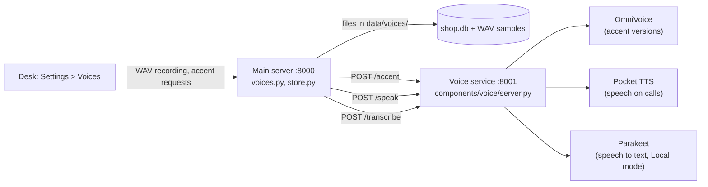
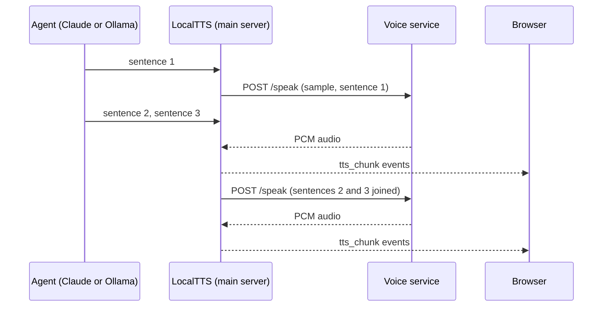

# Voices: your own voice and its accents

## Summary

Staff record their voice on the desk. The agent can then speak with that voice on calls. The desk also makes accent versions of the voice, for example Indian or British. Everything runs on this Mac, for free. The Local and Claude modes use the chosen voice. Gemini always uses its own voice.

## In simple words

1. Open the desk, then **Settings**.
2. Under **Add Your Voice**, read the script aloud and select **Start Recording**. Select **Stop Recording** when you finish. You can also select **Upload a File**.
3. Play the recording. If it sounds clear, enter a name and select **Save Voice**.
4. The voice shows under **Voice on Calls**. The first row, **Original accent**, is your recording exactly as you spoke.
5. To add an accent, choose it under the voice and select **Make Accent**. It takes about 20 seconds. The new row plays the same voice with the new accent.
6. Select **Preview** to hear a row the way callers hear it.
7. Select **Use** on the row you want on calls. The next call speaks with it.
8. To go back to the standard voice, select **Use** on **Cartesia Voice**.

Tips for a good recording:

- Use a quiet room with no echo, fan or music.
- Hold the microphone close.
- Read the whole script at your normal pace, in 6 to 15 seconds.

An accent version keeps the sound of the voice and changes how the words are spoken. The result is close, not perfect. Listen to each one before you use it.

Only record a voice with the permission of its owner. Callers hear it as a real person.

## Start the voice service

The voices need a second process, the local voice service. Set it up once, from the repository root:

1. Run `make install-voice` once. It installs the packages.
2. Accept the terms of the Pocket TTS model at https://huggingface.co/kyutai/pocket-tts with a free Hugging Face account.
3. Run `uvx hf auth login` once and paste a Read token from https://huggingface.co/settings/tokens.
4. Run `make dev-py` as usual. It also starts the voice service on port 8001. To run the service alone, use `make dev-voice`. The first start downloads the two models.
5. Wait for `Voice service: ready` in the log, about 10 seconds after the download.

If step 2 or 3 is missing, the desk shows what to do.

The desk says so when the service is off or still loading. You can record voices without the service. Making accents, previews and calls with a saved voice need it.

## Architecture

Two models make the voices, because no single local model is both good at accents and fast. A third model hears the customer in the Local mode:

| Model | Job | Runs on | Speed on an M4 |
|-------|-----|---------|----------------|
| OmniVoice (`mlx-community/OmniVoice-bf16`) | Clones the recording and speaks a sample line with an accent | GPU (MLX) | About 20 s per accent |
| Pocket TTS (`kyutai/pocket-tts`) | Clones one sample and speaks the agent's replies, streamed | CPU (PyTorch) | First audio in about 0.03 s. A 5 s sentence takes 0.7 s. |
| Parakeet (`mlx-community/parakeet-tdt-0.6b-v3`) | Turns the customer's speech into text in the Local mode | GPU (MLX) | About 0.09 s for 4 s of speech |

Pocket TTS runs on the CPU, so it does not slow down the local language model on the GPU. During a call, Pocket TTS clones the sample of the voice in use. For an accent version, the sample is the OmniVoice output, so the call carries that accent.

## Technical details

### Files

| File | Responsibility |
|------|---------------|
| `components/voice/server.py` | The voice service: loads Parakeet and OmniVoice (MLX) and Pocket TTS (PyTorch), and serves `/health`, `/accent`, `/speak` and `/transcribe` |
| `components/voice/pyproject.toml` | Its own environment (`mlx-audio`, `pocket-tts`), apart from the main server |
| `components/python/src/voices.py` | Script, accents, checks, accent and preview requests, the active voice |
| `components/python/src/local_tts.py` | `LocalTTS`, with the same methods as `CartesiaTTS` |
| `components/python/src/local_stt.py` | `LocalSTT`, with the same methods as `AssemblyAISTT`. Finds the turns with a level check per 20 ms frame. |
| `components/python/src/local_live.py` | `LocalLiveSession`: the Local mode as voice to voice, with barge-in |
| `components/python/src/store.py` | `voices` table and the `data/voices/` folder |
| `components/web/src/lib/desk/VoicesSection.svelte` | The Voices part of Settings |
| `components/web/src/lib/desk/recorder.ts` | Microphone recording and conversion to WAV |

### Storage

- The `voices` table has `id`, `name`, `accent` (empty for the original), `parent_id` (the original, for an accent version), `ref_text` and `created_at`.
- The sample of voice `<id>` is `components/python/data/voices/<id>.wav`: 16-bit mono at 24 kHz.
- `ref_text` holds the words in the sample. It is the script for an original and `SAMPLE_LINE` for an accent version. OmniVoice needs the exact words.
- The setting `voice_id` holds the voice in use. It is empty for Cartesia.
- Deleting an original deletes its accent versions and their files. Deleting the voice in use switches calls back to Cartesia.

### Recording

The browser records with `MediaRecorder`. `toWav` in `recorder.ts` decodes the take, resamples it to 24 kHz mono with an `OfflineAudioContext` and writes a 16-bit WAV. An uploaded file goes through the same conversion. The server accepts only that format, 6 to 15 seconds long. The body is the WAV itself, with the name as a query parameter, so the server needs no form parser.

### Accents

`POST /api/voices/{id}/accents` sends the original sample, its words and the accent to the service. OmniVoice speaks `SAMPLE_LINE` with `instruct="<accent> accent"` and 16 steps, and writes the new sample. The accents are the ten that OmniVoice supports for English: American, British, Australian, Canadian, Indian, Chinese, Korean, Japanese, Portuguese and Russian.

### Calls

`_tts_stream` in `main.py` calls `voices.make_tts()` once per session. With a voice in use it gets a `LocalTTS`. Otherwise it gets `CartesiaTTS`. `LocalTTS` queues the text of each sentence. The service streams the audio of each request as it is generated, and each part goes to the browser as a `tts_chunk` event. When one request ends, the text that arrived meanwhile is joined into the next request.

Measured on an M4 in the ollama pipeline, the voice starts 0.2–0.3 s after the agent's first words. A turn with a tool call starts to speak about 1.7–2.1 s after the customer stops. A turn with no tool call starts after about 0.7 s. Most of that time is the language model.

### Voice to voice in the Local mode

The local model (`qwen3.5:4b`) cannot hear or speak. `LocalLiveSession` puts `LocalSTT` before it and the desk voice after it, so the whole call runs on this Mac:

1. `LocalSTT` gets the microphone audio. It finds where speech starts and ends from the level of each 20 ms frame. While the customer speaks, it sends the speech so far to `/transcribe` every 0.5 s (`stt_chunk`). After 0.6 s of silence it sends the whole turn (`stt_output`).
2. The `OllamaHarness` answers, as before.
3. The reply goes to the voice one sentence at a time.

When text is heard while the agent thinks or its audio still plays, the agent stops: the session cancels the speech, sets `harness.cut`, and sends `interrupted`. The browser drops the queued audio. Tools that already started still finish, so the order and the history stay in step. After 8 s of silence the agent asks "Hello, are you there?".

If the voice service has no STT ready, AssemblyAI listens. With no desk voice in use, Cartesia speaks.

The service caches each sample's voice state by path and file time. Each model has its own lock, so speech on a call never waits for an accent being made. On start, the service speaks one word, so the first call is not slower.

### API

| Route | Action |
|-------|--------|
| `GET /api/voices` | Voices with their accent versions, the voice in use, the service status, the script and the accents |
| `POST /api/voices?name=<name>` | Save a recording. The body is the WAV file. |
| `DELETE /api/voices/{id}` | Delete a voice. An original takes its accent versions with it. |
| `POST /api/voices/{id}/accents` | Make an accent version: `{"accent": "indian"}` |
| `GET /api/voices/{id}/audio` | The sample WAV |
| `POST /api/voices/{id}/preview` | A test line spoken the way callers hear it, as WAV |
| `PUT /api/voices/active` | Choose the voice for calls: `{"id": 3}`, or `{"id": null}` for Cartesia |

### Configuration

| Variable | Default | Purpose |
|----------|---------|---------|
| `LOCAL_VOICE_URL` | `http://127.0.0.1:8001` | Where the main server finds the voice service |
| `LOCAL_VOICE_PORT` | `8001` | The voice service port |
| `LOCAL_ACCENT_MODEL` | `mlx-community/OmniVoice-bf16` | Model for accent versions |
| `LOCAL_STT_MODEL` | `mlx-community/parakeet-tdt-0.6b-v3` | Speech to text for the Local mode. `mlx-community/whisper-large-v3-turbo` also works. |
| `LOCAL_STT_SILENCE_MS` | `600` | Silence before the customer's turn ends, in the Local mode |
| `CARTESIA_VOICE_ID` | Cartesia's default voice | The Cartesia voice, when no desk voice is in use |

### Troubleshooting

| What you see | Cause | Fix |
|--------------|-------|-----|
| No audio on a call. The log shows `Local voice: can't speak (All connection attempts failed)`. | The voice service is off. Cartesia is the fallback, and it has no credits, so nothing speaks. | Stop `make dev-py` and start it again. Wait for `Voice service: ready`. |
| The log shows `Local voice: the voice service is off` when a call starts. | Same as above. The main server checks the service at the start of each call. | Same as above. |
| `make dev-voice` fails with `address already in use`. | A copy of the service already runs on port 8001. | Use the running copy, or stop it first: `lsof -nP -iTCP:8001 -sTCP:LISTEN` shows its process ID. |
| The desk says the voice service is still loading. | The models load in about 10 seconds after start, longer on the first download. | Select **Check Again** after `Voice service: ready` shows in the log. |
| The desk shows a Pocket TTS error about voice cloning weights. | The Hugging Face terms are not accepted, or there is no login. | Do steps 2 and 3 of [Start the voice service](#start-the-voice-service), then restart. |

A `WebSocketDisconnect` traceback at the end of a call is the browser closing the connection. It is not an error in the voice.

### Known limits

- The service needs an Apple silicon Mac, because it runs on MLX.
- Pocket TTS needs the Hugging Face terms accepted and a login, once.
- Speech is English only.
- Accent versions are approximate. Some words can sound wrong. Listen before you use one.
- Gemini cannot use a desk voice.
- Local speech to text can mishear dish names, for example "paneer tikka".
- Barge-in needs the browser's echo cancellation. With loud speakers and no headset, the agent can hear itself and stop.
- A recording that does not match the script makes worse accent versions.
